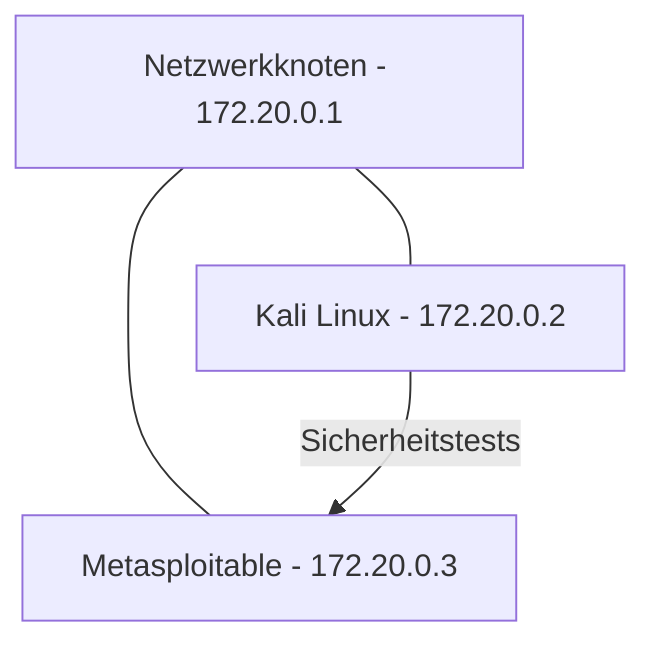
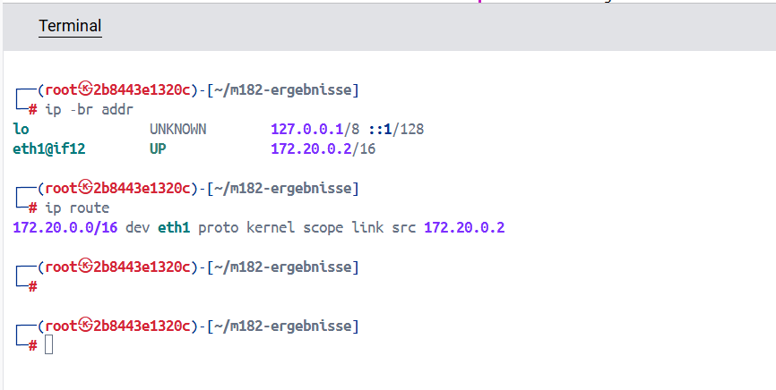
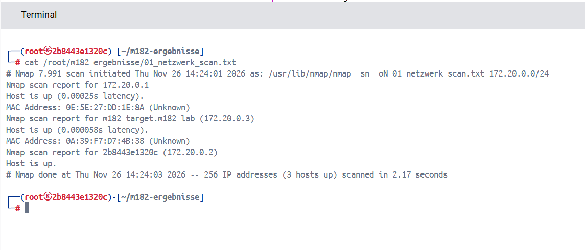
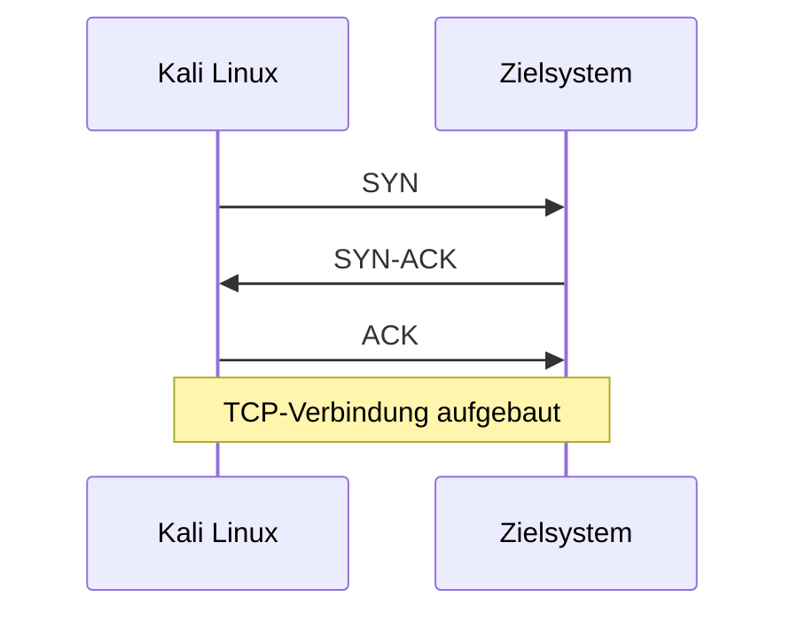
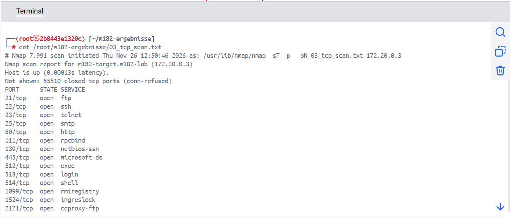
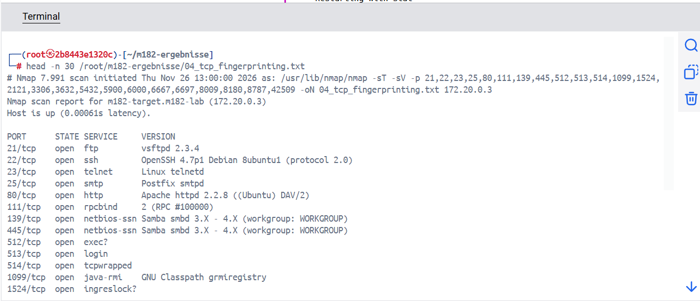
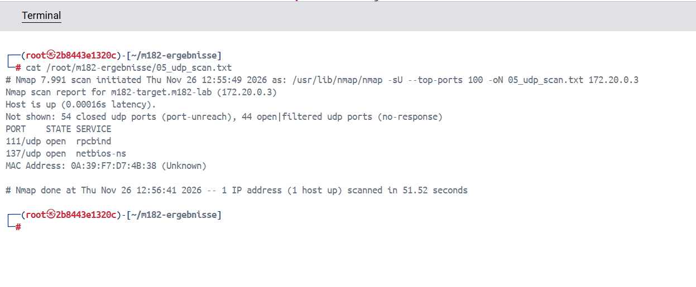
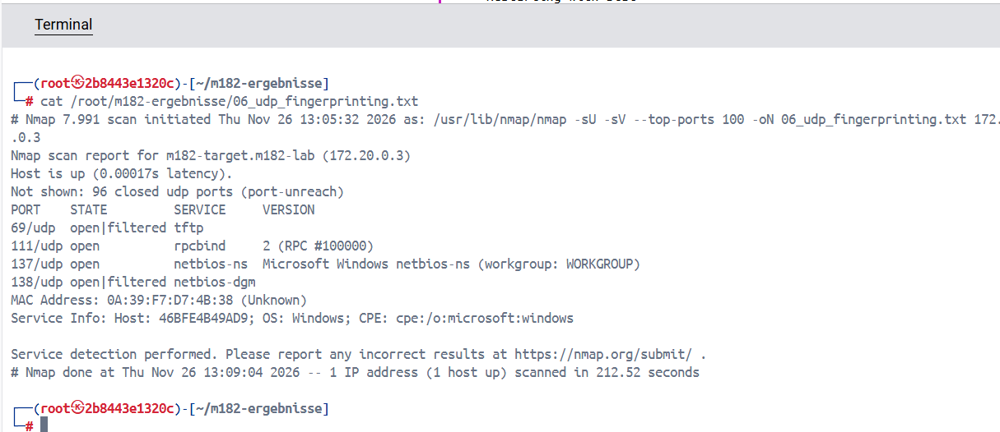
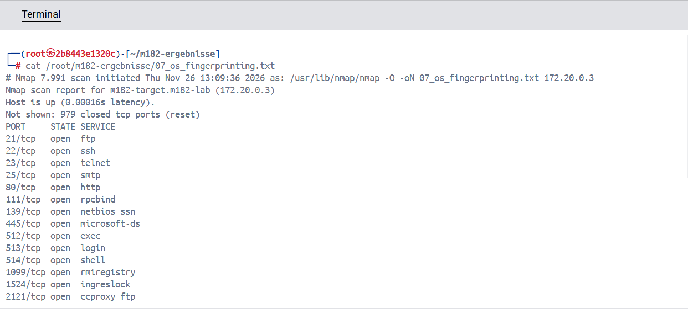
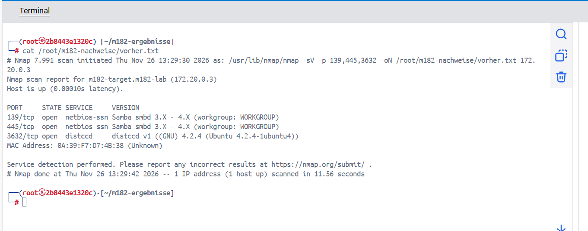

# M182 – Auftrag 01: Enumeration / Fingerprinting

**Modul:** M182  
**Auftrag:** Enumeration und Fingerprinting  
**Datum:** 26.11.2026  

---

## Inhaltsverzeichnis

- [1. Ausgangslage und Ziel](#1-ausgangslage-und-ziel)
- [2. Lab-Umgebung](#2-lab-umgebung)
- [3. Vorbereitung und Fehlerbehebung](#3-vorbereitung-und-fehlerbehebung)
- [4. Vorgehensstrategie](#4-vorgehensstrategie)
- [5. Netzwerkscan](#5-netzwerkscan)
- [6. TCP-Portscan](#6-tcp-portscan)
- [7. TCP-Fingerprinting](#7-tcp-fingerprinting)
- [8. UDP-Portscan](#8-udp-portscan)
- [9. UDP-Fingerprinting](#9-udp-fingerprinting)
- [10. Betriebssystem-Fingerprinting](#10-betriebssystem-fingerprinting)
- [11. Schwachstellenbewertung](#11-schwachstellenbewertung)
- [12. Exploit-Recherche](#12-exploit-recherche)
- [13. Praktische Untersuchung](#13-praktische-untersuchung)
- [14. Resilienz-Massnahmen](#14-resilienz-massnahmen)
- [15. Zusammenfassung](#15-zusammenfassung)
- [16. Fazit und Reflexion](#16-fazit-und-reflexion)

---

## 1. Ausgangslage und Ziel

Im Rahmen des Moduls M182 untersuche ich ein absichtlich verwundbares Zielsystem innerhalb einer isolierten Lab-Umgebung.

Das Ziel dieses Auftrags besteht darin, aktive Systeme innerhalb eines Netzwerks zu identifizieren, offene TCP- und UDP-Ports zu erkennen und Informationen über laufende Dienste sowie deren Softwareversionen zu sammeln.

Anhand dieser Informationen werden bekannte Schwachstellen recherchiert und geeignete Gegenmassnahmen zur Verbesserung der Systemsicherheit erarbeitet.

Alle Untersuchungen finden ausschliesslich innerhalb der autorisierten Testumgebung statt und dienen schulischen Lernzwecken.

---

## 2. Lab-Umgebung

Für diesen Auftrag verwende ich eine containerbasierte Lab-Umgebung mit Kali Linux und einem Metasploitable-Zielsystem.

### Systemübersicht

| System | IP-Adresse | Hostname | Funktion |
|---|---|---|---|
| Netzwerkknoten | 172.20.0.1 | Unbekannt | Vermutlich Docker-Bridge |
| Kali Linux | 172.20.0.2 | 2b8443e1320c | Testsystem |
| Metasploitable | 172.20.0.3 | m182-target.m182-lab | Verwundbares Zielsystem |

### Netzwerkkonfiguration

| Eigenschaft | Wert |
|---|---|
| Umgebung | Containerbasierte Lab-Umgebung |
| Netzwerkschnittstelle | eth1 |
| Netzwerkbereich | 172.20.0.0/16 |
| Subnetzmaske | 255.255.0.0 |
| Gescannter Netzwerkbereich | 172.20.0.0/24 |
| Nmap-Version | 7.991 |

### Netzwerkaufbau



### Überprüfung der Netzwerkkonfiguration

Zur Überprüfung der Netzwerkkonfiguration habe ich folgende Befehle verwendet:

```bash
ip -br addr
ip route
```

Ergebnis:

```text
lo          UNKNOWN    127.0.0.1/8 ::1/128
eth1@if12   UP         172.20.0.2/16

172.20.0.0/16 dev eth1 proto kernel scope link src 172.20.0.2
```

### Screenshot



---

## 3. Vorbereitung und Fehlerbehebung

Zuerst habe ich die benötigten Programme auf Kali Linux installiert.

```bash
apt update
apt install -y nmap iproute2 iputils-ping
```

Bei der anschliessenden Überprüfung von Nmap trat folgende Fehlermeldung auf:

```text
/usr/bin/nmap: 6: exec: /usr/lib/nmap/nmap: Operation not permitted
```

Zur Untersuchung des Problems habe ich die Dateiberechtigungen und Linux-Capabilities überprüft.

```bash
ls -l /usr/lib/nmap/nmap
apt install -y libcap2-bin
getcap /usr/lib/nmap/nmap
setcap -r /usr/lib/nmap/nmap
nmap --version
```

Nach dem Entfernen der Dateicapabilities konnte Nmap erfolgreich verwendet werden.

Die Fehlermeldung deutet auf eingeschränkte Berechtigungen innerhalb der Container-Umgebung hin.

Für den vollständigen TCP-Portscan habe ich einen TCP Connect Scan anstelle eines TCP-SYN-Scans verwendet.

Zur Speicherung der Ergebnisse habe ich ein separates Verzeichnis erstellt.

```bash
mkdir -p /root/m182-ergebnisse
cd /root/m182-ergebnisse
```

---

## 4. Vorgehensstrategie

Für die Durchführung des Auftrags wurde folgende Strategie verwendet:

1. Lab-Umgebung vorbereiten und überprüfen.
2. Netzwerkkonfiguration ermitteln.
3. Erreichbare Systeme identifizieren.
4. Sämtliche TCP-Ports untersuchen.
5. Dienste und Softwareversionen identifizieren.
6. UDP-Portscan durchführen.
7. Betriebssystem-Fingerprinting durchführen.
8. Bekannte Schwachstellen recherchieren.
9. Eine ausgewählte Schwachstelle praktisch untersuchen.
10. Geeignete Resilienz-Massnahmen definieren.

### Verwendete Werkzeuge

| Werkzeug | Verwendungszweck |
|---|---|
| Kali Linux | Testsystem für Sicherheitsanalysen |
| Metasploitable | Absichtlich verwundbares Zielsystem |
| Nmap | Netzwerk-, Port- und Versionsscanning |
| iproute2 | Überprüfung der Netzwerkkonfiguration |
| CVE / NVD | Recherche bekannter Schwachstellen |
| GitHub | Dokumentation der Arbeitsresultate |

### Code of Conduct

Bei der Durchführung von Sicherheitstests müssen rechtliche und ethische Rahmenbedingungen berücksichtigt werden.

Die Untersuchungen beschränken sich auf die dafür vorgesehene Lab-Umgebung. Fremde Systeme und produktive Netzwerke sind nicht Bestandteil dieses Auftrags.

---

## 5. Netzwerkscan

### Ziel

Durch die Enumeration sollen aktive Systeme innerhalb des ausgewählten Netzwerkbereichs identifiziert werden.

### Durchführung

```bash
nmap -sn 172.20.0.0/24 -oN 01_host_discovery.txt
```

Der erste Scan wurde um 12:46 Uhr durchgeführt. Dabei wurden zwei erreichbare Systeme identifiziert.

Anschliessend wurde der Scan wiederholt.

```bash
nmap -sn 172.20.0.0/24 -oN 02_host_discovery_final.txt
```

Beim zweiten Scan wurde zusätzlich das Metasploitable-Zielsystem erkannt.

Zur abschliessenden Überprüfung wurde folgender Scan durchgeführt:

```bash
nmap -sn 172.20.0.0/24 -oN 01_netzwerk_scan.txt
```

### Erklärung der Parameter

| Parameter | Beschreibung |
|---|---|
| `-sn` | Host Discovery ohne regulären Portscan |
| `-oN` | Speicherung der Ergebnisse in einer Textdatei |
| `/24` | Untersuchung eines Bereichs mit 256 IP-Adressen |

### Ergebnisse

| IP-Adresse | System | MAC-Adresse | Status |
|---|---|---|---|
| 172.20.0.1 | Netzwerkknoten | 0E:5E:27:DD:1E:8A | Up |
| 172.20.0.2 | Kali Linux | Nicht ausgegeben | Up |
| 172.20.0.3 | Metasploitable | 0A:39:F7:D7:4B:38 | Up |

### Scan-Zusammenfassung

| Eigenschaft | Ergebnis |
|---|---|
| Untersuchte IP-Adressen | 256 |
| Erreichbare Systeme | 3 |
| Scan-Dauer | 2.17 Sekunden |
| Scan-Zeitpunkt | 14:24 Uhr |

### Screenshot



### Auswertung

Beim Netzwerkscan wurden insgesamt drei erreichbare Systeme identifiziert.

Neben dem Kali-Linux-Testsystem und dem Metasploitable-Zielsystem wurde ein weiterer Netzwerkknoten erkannt. Vermutlich handelt es sich dabei um die virtuelle Netzwerk-Bridge. Diese Funktion wurde nicht separat überprüft.

Für die weiteren Untersuchungen wurde das Zielsystem mit der IP-Adresse 172.20.0.3 ausgewählt.

---

## 6. TCP-Portscan

### Ziel

Mit dem TCP-Portscan sollen alle offenen TCP-Ports des Zielsystems identifiziert werden.

### Durchführung

```bash
nmap -sT -p- 172.20.0.3 -oN 03_tcp_scan.txt
```

### Erklärung der Parameter

| Parameter | Beschreibung |
|---|---|
| `-sT` | TCP Connect Scan |
| `-p-` | Untersuchung aller 65535 regulären TCP-Ports |
| `-oN` | Speicherung der Scan-Ergebnisse |

Beim TCP Connect Scan wird eine vollständige TCP-Verbindung aufgebaut.

Im Gegensatz zum SYN-Scan wird der TCP-Drei-Wege-Handshake vollständig abgeschlossen.

### TCP-Drei-Wege-Handshake



### Ergebnisse

| Eigenschaft | Ergebnis |
|---|---|
| Ziel-IP | 172.20.0.3 |
| Untersuchte TCP-Ports | 65535 |
| Offene TCP-Ports | 25 |
| Geschlossene TCP-Ports | 65510 |
| Scan-Dauer | 2.59 Sekunden |
| Scan-Zeitpunkt | 12:50 Uhr |

### Screenshot



### Auswertung

Der vollständige TCP-Portscan hat insgesamt 25 offene Ports ergeben.

Die grosse Anzahl erreichbarer Dienste führt zu einer entsprechend grossen potenziellen Angriffsfläche.

Ein offener Port bedeutet jedoch nicht automatisch, dass eine Schwachstelle vorhanden ist. Deshalb wurde anschliessend eine detaillierte Versionserkennung durchgeführt.

---

## 7. TCP-Fingerprinting

### Ziel

Beim Fingerprinting werden Informationen über laufende Dienste und deren Softwareversionen gesammelt.

Diese Informationen können anschliessend für die Recherche bekannter Schwachstellen verwendet werden.

### Durchführung

```bash
nmap -sT -sV -p- -oN 03_tcp_scan_v2.txt 172.20.0.3
```

Zusätzlich wurde ein gezielter Fingerprinting-Scan der zuvor identifizierten offenen Ports durchgeführt.

### Erklärung der Parameter

| Parameter | Beschreibung |
|---|---|
| `-sT` | TCP Connect Scan |
| `-sV` | Erkennung von Diensten und Versionen |
| `-p-` | Untersuchung aller regulären TCP-Ports |

### Gefundene Dienste und Versionen

| Port | Status | Dienst | Version / Fingerprint |
|---|---|---|---|
| 21/TCP | Open | FTP | vsftpd 2.3.4 |
| 22/TCP | Open | SSH | OpenSSH 4.7p1 Debian 8ubuntu1 |
| 23/TCP | Open | Telnet | Linux telnetd |
| 25/TCP | Open | SMTP | Postfix smtpd |
| 80/TCP | Open | HTTP | Apache httpd 2.2.8 Ubuntu DAV/2 |
| 111/TCP | Open | rpcbind | Version 2 |
| 139/TCP | Open | NetBIOS | Samba smbd 3.X–4.X |
| 445/TCP | Open | SMB | Samba smbd 3.X–4.X |
| 512/TCP | Open | exec? | Nicht eindeutig erkannt |
| 513/TCP | Open | login | Version unbekannt |
| 514/TCP | Open | tcpwrapped | Version unbekannt |
| 1099/TCP | Open | Java RMI | GNU Classpath grmiregistry |
| 1524/TCP | Open | ingreslock? | Nicht eindeutig erkannt |
| 2121/TCP | Open | FTP | ProFTPD 1.3.1 |
| 3306/TCP | Open | MySQL | MySQL 5.0.51a-3ubuntu5 |
| 3632/TCP | Open | distccd | distccd v1, GNU 4.2.4 |
| 5432/TCP | Open | PostgreSQL | PostgreSQL 8.3.0–8.3.7 |
| 5900/TCP | Open | VNC | Protokoll 3.3 |
| 6000/TCP | Open | X11 | Access denied |
| 6667/TCP | Open | IRC | UnrealIRCd |
| 6697/TCP | Open | IRC | UnrealIRCd |
| 8009/TCP | Open | AJP | Apache Jserv, Protokoll 1.3 |
| 8180/TCP | Open | HTTP | Apache Tomcat/Coyote JSP engine 1.1 |
| 8787/TCP | Open | DRb | Ruby DRb RMI, Ruby 1.8 |
| 42509/TCP | Open | Java RMI | GNU Classpath grmiregistry |

### Zusätzliche Beobachtungen

Beim späteren vollständigen Fingerprinting meldete der MySQL-Dienst zu viele Verbindungsfehler.

Die genaue MySQL-Version konnte jedoch bereits im früheren Fingerprinting-Scan festgestellt werden.

Ein weiterer Dienst konnte von Nmap nicht eindeutig identifiziert werden. Seine Antworten deuteten auf eine möglicherweise ungeschützte Kommandozeile mit erhöhten Berechtigungen hin.

Dieser Befund stellt ein potenziell erhebliches Sicherheitsrisiko dar.

### Scan-Zusammenfassung

| Eigenschaft | Ergebnis |
|---|---|
| Offene TCP-Ports | 25 |
| Dauer des gezielten Fingerprintings | 152.72 Sekunden |
| Dauer des vollständigen Fingerprintings | 157.74 Sekunden |
| Ziel-MAC-Adresse | 0A:39:F7:D7:4B:38 |

### Screenshot



### Auswertung

Auf dem Zielsystem wurden zahlreiche veraltete Netzwerkdienste identifiziert.

Insbesondere die älteren FTP-, SSH-, HTTP-, Samba- und Datenbankdienste stellen mögliche Sicherheitsrisiken dar.

Die identifizierten Versionen dienen als Grundlage für die anschliessende Schwachstellenrecherche.

---

## 8. UDP-Portscan

### Ziel

Neben den TCP-Ports wurden auch die UDP-Ports des Zielsystems untersucht.

### Durchführung

```bash
nmap -sU --top-ports 100 172.20.0.3 -oN 05_udp_scan.txt
```

### Erklärung der Parameter

| Parameter | Beschreibung |
|---|---|
| `-sU` | UDP-Portscan |
| `--top-ports 100` | Untersuchung der 100 häufigsten UDP-Ports |
| `-oN` | Speicherung der Ergebnisse |

UDP ist ein verbindungsloses Protokoll. Im Gegensatz zu TCP wird kein Drei-Wege-Handshake durchgeführt.

Wenn ein UDP-Port keine Antwort zurücksendet, kann unter Umständen nicht eindeutig festgestellt werden, ob er geöffnet oder gefiltert ist.

### Ergebnisse

| Port | Status | Dienst |
|---|---|---|
| 111/UDP | Open | rpcbind |
| 137/UDP | Open | netbios-ns |

### Scan-Zusammenfassung

| Portzustand | Anzahl |
|---|---:|
| Offen | 2 |
| Geschlossen | 54 |
| Open oder filtered | 44 |
| Total | 100 |

Die Scan-Dauer betrug 51.52 Sekunden.

### Screenshot



### Auswertung

Beim ersten UDP-Portscan wurden zwei eindeutig offene UDP-Ports identifiziert.

Bei weiteren 44 Ports konnte nicht eindeutig zwischen einem offenen und einem gefilterten Zustand unterschieden werden.

Deshalb wurde anschliessend ein zusätzlicher UDP-Scan mit Versionserkennung durchgeführt.

---

## 9. UDP-Fingerprinting

### Durchführung

```bash
nmap -sU -sV --top-ports 100 172.20.0.3 -oN 06_udp_fingerprinting.txt
```

### Ergebnisse

| Port | Status | Dienst | Version |
|---|---|---|---|
| 69/UDP | open\|filtered | TFTP | Nicht ermittelt |
| 111/UDP | open | rpcbind | Version 2 |
| 137/UDP | open | NetBIOS-NS | Microsoft Windows NetBIOS-NS, WORKGROUP |
| 138/UDP | open\|filtered | NetBIOS-DGM | Nicht ermittelt |

### Vergleich der UDP-Scans

| Portzustand | Erster Scan | Fingerprinting |
|---|---:|---:|
| Offen | 2 | 2 |
| Geschlossen | 54 | 96 |
| Open oder filtered | 44 | 2 |
| Total | 100 | 100 |
| Dauer | 51.52 s | 212.52 s |

### Screenshot



### Auswertung

Der zusätzliche UDP-Scan mit Versionserkennung lieferte genauere Ergebnisse.

Beim ersten Scan wurden 44 Ports als `open|filtered` klassifiziert. Nach dem Fingerprinting waren es nur noch zwei.

Die Ports 111 und 137 wurden bei beiden Scans eindeutig als offen erkannt.

Die Ports 69 und 138 konnten nicht abschliessend als offen bestätigt werden.

Die Ergebnisse zeigen, dass UDP-Fingerprinting deutlich mehr Zeit benötigt, dafür aber zusätzliche Informationen über die Dienste und Portzustände liefern kann.

---

## 10. Betriebssystem-Fingerprinting

### Ziel

Durch das Betriebssystem-Fingerprinting soll das verwendete Betriebssystem des Zielsystems identifiziert werden.

### Durchführung

```bash
nmap -O 172.20.0.3 -oN 07_os_fingerprinting.txt
```

Der Parameter `-O` aktiviert die Betriebssystemerkennung von Nmap.

### Ergebnisse

| Eigenschaft | Ergebnis |
|---|---|
| Device Type | General purpose / Router |
| Running | Linux 4.X / 5.X, MikroTik RouterOS 7.X |
| Mögliche Linux-Kernel-Versionen | 4.15–5.19 |
| Weitere mögliche Systeme | OpenWrt 21.02, MikroTik RouterOS 7.2–7.5 |
| Network Distance | 1 Hop |
| Scan-Dauer | 1.78 Sekunden |

### Screenshot



### Auswertung

Das Betriebssystem konnte nicht eindeutig bestimmt werden.

Die Ergebnisse weisen hauptsächlich auf ein Linux-basiertes System hin.

Da eine containerbasierte Umgebung verwendet wird, können die ermittelten Kernel-Eigenschaften vom Hostsystem stammen. Container teilen sich üblicherweise den Kernel des Hosts.

Beim UDP-Fingerprinting wurde zusätzlich ein Windows-Hinweis ausgegeben. Dieser stammt aus der Erkennung des NetBIOS-Dienstes und ist kein eindeutiger Nachweis eines Windows-Betriebssystems.

Das Ergebnis zeigt, dass die automatische Betriebssystemerkennung nicht immer eindeutig ist und kritisch beurteilt werden muss.

---

## 11. Schwachstellenbewertung

Anhand der identifizierten Dienste und Versionen wurden mögliche Sicherheitsrisiken untersucht.

### Auffällige Dienste

| Dienst | Version | Mögliches Sicherheitsproblem |
|---|---|---|
| FTP | vsftpd 2.3.4 | Historisch bekannte Backdoor |
| SSH | OpenSSH 4.7p1 | Veraltete Software |
| Telnet | Linux telnetd | Unverschlüsselte Kommunikation |
| HTTP | Apache 2.2.8 | Veralteter Webserver |
| SMB | Samba 3.X–4.X | Mögliche bekannte Schwachstellen |
| distccd | distccd v1 | Möglicherweise unzureichende Zugriffsbeschränkung |
| MySQL | 5.0.51a | Veraltete Datenbanksoftware |
| PostgreSQL | 8.3.X | Veraltete Datenbanksoftware |
| VNC | Protokoll 3.3 | Veraltetes Fernzugriffsprotokoll |

Die aufgeführten Sicherheitsprobleme stellen mögliche Risiken dar. Die tatsächliche Ausnutzbarkeit einer Schwachstelle hängt von der eingesetzten Softwareversion und Konfiguration ab.

### OpenVAS

OpenVAS ist ein automatisierter Schwachstellenscanner, mit dem bekannte Sicherheitslücken und unsichere Konfigurationen identifiziert werden können.

Für die bisherige Untersuchung liegen dokumentierte Nmap-Ergebnisse vor. Ein separater OpenVAS-Bericht liegt bisher nicht vor.

---

## 12. Exploit-Recherche

Auf Grundlage der gefundenen Dienste wurden zwei mögliche Exploits recherchiert.

Die Auswahl konzentriert sich auf Samba und distccd, da beide Dienste im zusätzlichen Kontrollscan eindeutig als erreichbar identifiziert wurden.

### 12.1 Exploit 1 – Samba Remote Command Injection

| Eigenschaft | Beschreibung |
|---|---|
| CVE | CVE-2007-2447 |
| Software | Samba |
| Betroffene Versionen | 3.0.0 bis 3.0.25rc3 |
| Dienst | SMB |
| Ports | 139/TCP und 445/TCP |
| Erkannte Version | Samba smbd 3.X–4.X |
| Schwachstellentyp | Remote Command Injection |
| Mögliches Risiko | Unautorisierte Befehlsausführung |

#### Beschreibung

Bestimmte ältere Samba-Versionen enthalten eine Schwachstelle bei der Verarbeitung von Benutzereingaben.

Unter bestimmten Konfigurationsbedingungen können nicht ausreichend überprüfte Eingaben zur Ausführung von Betriebssystembefehlen führen.

Eine betroffene Konfigurationsoption ist das Username Mapping über externe Skripte.

#### Bezug zur Lab-Umgebung

Beim Fingerprinting wurden Samba-Dienste auf den Ports 139 und 445 identifiziert.

Da Nmap lediglich den Versionsbereich 3.X–4.X erkannt hat, kann nicht abschliessend bestätigt werden, dass eine von CVE-2007-2447 betroffene Version eingesetzt wird.

#### Mögliche Auswirkungen

- Unautorisierte Befehlsausführung
- Zugriff auf vertrauliche Informationen
- Manipulation von Dateien
- Kompromittierung des Zielsystems

#### Gegenmassnahmen

- Samba auf eine aktuelle und unterstützte Version aktualisieren.
- Unsichere Konfigurationsoptionen deaktivieren.
- SMB-Zugriffe auf autorisierte Systeme beschränken.

#### Quellen

- [NIST – CVE-2007-2447](https://nvd.nist.gov/vuln/detail/CVE-2007-2447)
- [Samba Security Advisory](https://www.samba.org/samba/security/CVE-2007-2447.html)

---

### 12.2 Exploit 2 – distccd Remote Command Execution

| Eigenschaft | Beschreibung |
|---|---|
| CVE | CVE-2004-2687 |
| Software | distcc |
| Betroffene Software laut NVD | distcc 2.x |
| Dienst | distccd |
| Port | 3632/TCP |
| Erkannter Fingerprint | distccd v1, GNU 4.2.4 |
| Schwachstellentyp | Remote Command Execution |

#### Beschreibung

Distcc ist ein Werkzeug zur Verteilung von Kompilierungsaufgaben auf mehrere Computer.

Bei unzureichender Zugriffsbeschränkung können betroffene distcc-Versionen fremde Aufträge ohne ausreichende Autorisierungsprüfung verarbeiten.

Dadurch besteht das Risiko, dass nicht autorisierte Benutzer Befehle auf dem Zielsystem ausführen können.

#### Bezug zur Lab-Umgebung

Beim TCP-Fingerprinting wurde der Port 3632 als offen erkannt.

Nmap identifizierte den Dienst als:

```text
distccd v1 ((GNU) 4.2.4 (Ubuntu 4.2.4-1ubuntu4))
```

Die Angabe GNU 4.2.4 bezieht sich auf den Compiler und stellt nicht zwingend die installierte distcc-Paketversion dar.

Die tatsächliche Betroffenheit von CVE-2004-2687 muss deshalb separat bestätigt werden.

#### Mögliche Auswirkungen

- Unautorisierte Befehlsausführung
- Zugriff auf Systemressourcen
- Manipulation von Dateien
- Kompromittierung des Dienstes

#### Gegenmassnahmen

- Nicht benötigte distccd-Dienste deaktivieren.
- Zugriff auf vertrauenswürdige Systeme beschränken.
- Aktuelle Softwareversionen verwenden.
- Dienste mit minimalen Berechtigungen betreiben.

#### Quellen

- [NIST – CVE-2004-2687](https://nvd.nist.gov/vuln/detail/CVE-2004-2687)
- [Rapid7 – Metasploitable 2 Exploitability Guide](https://docs.rapid7.com/metasploit/metasploitable-2-exploitability-guide)

---

### 12.3 Vergleich der Exploits

| Eigenschaft | Samba | distccd |
|---|---|---|
| CVE | CVE-2007-2447 | CVE-2004-2687 |
| Dienst | SMB | Distributed Compiler |
| Port | 139 und 445 | 3632 |
| Dienst erreichbar | Ja | Ja |
| Schwachstellenart | Command Injection | Remote Command Execution |
| Mögliche Auswirkung | Befehlsausführung | Befehlsausführung |
| Schwachstelle praktisch bestätigt | Noch nicht | Noch nicht |

---

## 13. Praktische Untersuchung

### Vorbereitung

Vor einer möglichen Exploit-Durchführung wurden die ausgewählten Dienste erneut untersucht.

### Kontrollscan

```bash
mkdir -p /root/m182-nachweise

nmap -sV -p 139,445,3632 172.20.0.3 -oN /root/m182-nachweise/vorher.txt
```

### Ergebnis

```text
PORT     STATE SERVICE     VERSION
139/tcp  open  netbios-ssn Samba smbd 3.X - 4.X
445/tcp  open  netbios-ssn Samba smbd 3.X - 4.X
3632/tcp open  distccd     distccd v1 ((GNU) 4.2.4)
```

| Eigenschaft | Ergebnis |
|---|---|
| Zielsystem | m182-target.m182-lab |
| Ziel-IP | 172.20.0.3 |
| Scan-Datum | 26.11.2026 |
| Scan-Zeitpunkt | 13:29 Uhr |
| Scan-Dauer | 11.56 Sekunden |
| Erreichbare untersuchte Ports | 3 |

### Screenshot



### Auswertung

Der Kontrollscan bestätigt, dass die Samba-Dienste sowie der distccd-Dienst zum Zeitpunkt der Untersuchung erreichbar waren.

Die Erreichbarkeit der Dienste stellt jedoch noch keinen erfolgreichen Exploit-Nachweis dar.

Ein separater Nachweis einer erfolgreichen Exploit-Durchführung liegt in den bisher gespeicherten Ergebnissen nicht vor.

---

## 14. Resilienz-Massnahmen

Um vergleichbare Angriffe zu verhindern oder deren Auswirkungen zu reduzieren, wurden folgende Massnahmen erarbeitet.

### Massnahme 1 – Patchmanagement

Auf dem Zielsystem wurden zahlreiche veraltete Softwareversionen identifiziert.

Betriebssysteme und Anwendungen sollten regelmässig aktualisiert werden, damit bekannte Sicherheitslücken geschlossen werden können.

Insbesondere die älteren Samba-, FTP-, SSH- und Datenbankdienste sollten durch unterstützte Versionen ersetzt werden.

**Nutzen:**

- Bekannte Sicherheitslücken schliessen
- Schutz vor bekannten Exploits
- Verbesserung der Systemsicherheit

### Massnahme 2 – Unnötige Dienste deaktivieren

Der vollständige TCP-Portscan hat insgesamt 25 offene Ports ergeben.

Jeder zusätzliche erreichbare Dienst vergrössert die potenzielle Angriffsfläche.

Nicht benötigte Dienste wie Telnet, distccd und ältere Fernzugriffsdienste sollten deaktiviert oder deinstalliert werden.

**Nutzen:**

- Reduktion der Angriffsfläche
- Weniger offene Ports
- Weniger potenzielle Schwachstellen

### Massnahme 3 – Firewall und Netzwerksegmentierung

Der Zugriff auf Netzwerkdienste sollte durch geeignete Firewall-Regeln auf autorisierte Systeme beschränkt werden.

Insbesondere die Samba-Ports 139 und 445 sowie der distccd-Port 3632 sollten nur für Systeme erreichbar sein, welche diese Dienste tatsächlich benötigen.

Durch Netzwerksegmentierung kann ausserdem verhindert werden, dass sich ein Sicherheitsvorfall ungehindert auf weitere Systeme ausbreitet.

**Nutzen:**

- Einschränkung unautorisierter Zugriffe
- Schutz interner Netzwerkdienste
- Begrenzung möglicher Schäden

### Massnahme 4 – Minimale Berechtigungen

Dienste sollten nur mit den Berechtigungen betrieben werden, welche für ihre Funktion notwendig sind.

Nicht benötigte Shell-Zugänge und unsichere externe Skriptaufrufe sollten entfernt werden.

**Nutzen:**

- Begrenzung der Auswirkungen einer Kompromittierung
- Schutz kritischer Systemressourcen
- Reduktion möglicher Schäden

### Massnahme 5 – Monitoring und Logging

System- und Netzwerkaktivitäten sollten regelmässig überwacht werden.

Auffällige Verbindungsversuche und ungewöhnliche Systemaktivitäten können dadurch frühzeitig erkannt werden.

**Nutzen:**

- Frühzeitige Erkennung von Angriffen
- Nachvollziehbarkeit von Sicherheitsvorfällen
- Schnellere Reaktion auf Bedrohungen

### Zusammenfassung der Massnahmen

| Massnahme | Priorität | Ziel |
|---|---|---|
| Patchmanagement | Hoch | Bekannte Sicherheitslücken schliessen |
| Dienste deaktivieren | Hoch | Angriffsfläche reduzieren |
| Firewall und Segmentierung | Hoch | Netzwerkzugriffe beschränken |
| Minimale Berechtigungen | Hoch | Auswirkungen begrenzen |
| Monitoring und Logging | Mittel bis hoch | Angriffe erkennen |

Nach der Umsetzung der Gegenmassnahmen sollte ein erneuter Portscan durchgeführt werden, um deren Wirksamkeit zu überprüfen.

---

## 15. Zusammenfassung

### Untersuchungsergebnisse

| Untersuchung | Ergebnis |
|---|---|
| Gefundene Systeme | 3 |
| Untersuchte IP-Adressen | 256 |
| Untersuchte TCP-Ports | 65535 |
| Offene TCP-Ports | 25 |
| Geschlossene TCP-Ports | 65510 |
| Untersuchte UDP-Ports | 100 |
| Bestätigte offene UDP-Ports | 2 |
| UDP open oder filtered | 2 |
| Geschlossene UDP-Ports nach Fingerprinting | 96 |
| Betriebssystem | Linux-basiert, nicht eindeutig bestimmt |
| Recherchierte Exploits | 2 |
| Praktischer Exploit-Nachweis | Noch offen |
| Definierte Resilienz-Massnahmen | 5 |

### Gespeicherte Scan-Ergebnisse

| Datei | Inhalt |
|---|---|
| 01_host_discovery.txt | Erster Netzwerkscan |
| 01_netzwerk_scan.txt | Abschliessender Netzwerkscan |
| 02_host_discovery_final.txt | Netzwerkscan mit drei Hosts |
| 03_tcp_scan.txt | Vollständiger TCP-Portscan |
| 03_tcp_scan_v2.txt | Vollständiges TCP-Fingerprinting |
| 04_tcp_fingerprinting.txt | Gezieltes TCP-Fingerprinting |
| 05_udp_scan.txt | UDP-Portscan |
| 06_udp_fingerprinting.txt | UDP-Fingerprinting |
| 07_os_fingerprinting.txt | Betriebssystemerkennung |
| vorher.txt | Kontrollscan der ausgewählten Dienste |

---

## 16. Fazit und Reflexion

Durch diesen Auftrag konnte ich die grundlegenden Methoden der Enumeration und des Fingerprintings praktisch anwenden.

Mit Nmap habe ich drei erreichbare Systeme identifiziert und das ausgewählte Zielsystem auf sämtliche regulären TCP-Ports untersucht.

Dabei wurden insgesamt 25 offene TCP-Ports sowie zwei eindeutig offene UDP-Ports gefunden.

Besonders interessant war der Unterschied zwischen dem einfachen UDP-Portscan und dem zusätzlichen UDP-Fingerprinting. Durch die Versionserkennung konnten zahlreiche zuvor unklare Portzustände genauer bestimmt werden.

Eine Herausforderung war die eingeschränkte Ausführung von Nmap innerhalb der Container-Umgebung. Durch die Untersuchung der Dateiberechtigungen und Linux-Capabilities konnte das Problem behoben werden.

Die Betriebssystemerkennung hat ausserdem gezeigt, dass die Ergebnisse automatisierter Scans nicht immer eindeutig sind und kritisch beurteilt werden müssen.

Durch die Recherche von zwei bekannten Schwachstellen konnte ich nachvollziehen, welche Risiken durch veraltete Software und unsichere Konfigurationen entstehen können.

Der Auftrag verdeutlicht die Bedeutung von regelmässigen Sicherheitsupdates, Zugriffsbeschränkungen, Netzwerksegmentierung und der Deaktivierung unnötiger Dienste.
