# M182 – Auftrag 02: Systemhärtung eines Ubuntu Docker Containers

**Modul:** M182  
**Auftrag:** Hardening Ubuntu Container  
**Datum:** 26.11.2026  

---

## Inhaltsverzeichnis

- [1. Ausgangslage und Ziel](#1-ausgangslage-und-ziel)
- [2. Testumgebung](#2-testumgebung)
- [3. Vorbereitung des Containers](#3-vorbereitung-des-containers)
- [4. Fehlerbehebung](#4-fehlerbehebung)
- [5. IST-Zustand](#5-ist-zustand)
- [6. Härtungsmassnahmen](#6-härtungsmassnahmen)
- [7. Vorher-Nachher-Vergleich](#7-vorher-nachher-vergleich)
- [8. Container speichern](#8-container-speichern)
- [9. Erfolgskontrolle nach Neustart](#9-erfolgskontrolle-nach-neustart)
- [10. Reflexionsfragen](#10-reflexionsfragen)
- [11. Fazit](#11-fazit)

---

## 1. Ausgangslage und Ziel

Im Rahmen des Moduls M182 wird ein Ubuntu Docker Container systematisch gehärtet.

Unter Systemhärtung versteht man Massnahmen, welche die Sicherheit eines Systems erhöhen und dessen potenzielle Angriffsfläche reduzieren.

Das Ziel dieses Auftrags besteht darin, einen Ubuntu-Container mit einem SSH-Dienst vorzubereiten, dessen ursprünglichen Zustand zu analysieren und anschliessend gezielte Sicherheitsmassnahmen umzusetzen.

Die Wirksamkeit der einzelnen Massnahmen wird durch entsprechende Kontrollbefehle überprüft.

Folgende Sicherheitsbereiche werden untersucht:

- Benutzerverwaltung
- Administrative Berechtigungen
- SSH-Konfiguration
- Passwortsicherheit
- Netzwerkdienste
- Firewall-Konfiguration
- Entfernung unnötiger Software
- Speicherung eines gehärteten Container-Images

Alle Arbeiten finden innerhalb meiner lokalen Docker-Testumgebung statt.

---

## 2. Testumgebung

Für diesen Auftrag verwende ich Docker Desktop auf meinem Windows-System.

Die bereits vorhandenen Kali-Linux- und Metasploitable-Container aus Auftrag 01 bleiben unverändert.

### Systemübersicht

| Eigenschaft | Wert |
|---|---|
| Hostsystem | Windows |
| Virtualisierungsumgebung | Docker Desktop |
| Terminal auf dem Host | Windows PowerShell |
| Basis-Image | ubuntu:22.04 |
| Betriebssystem | Ubuntu 22.04 LTS |
| Containername | hardeninglab |
| Container-ID | a20c3d91624d |
| Architektur | amd64 |
| Netzwerkmodus | Docker Bridge |
| Netzwerkdienst | OpenSSH |
| SSH-Port | 22/TCP |
| Geplanter Image-Name | hardened-ubuntu |

### Aufbau der Umgebung

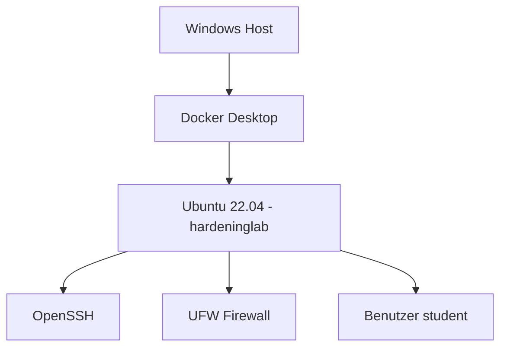

### Verwendete Werkzeuge

| Werkzeug | Verwendungszweck |
|---|---|
| Docker | Erstellung und Verwaltung des Containers |
| Ubuntu | Betriebssystem des Containers |
| APT | Paketverwaltung |
| OpenSSH | Verschlüsselter Fernzugriff |
| UFW | Verwaltung der Firewall |
| iptables | Überprüfung der Firewall-Regeln |
| iproute2 | Überprüfung der Netzwerkports |
| sudo | Verwaltung administrativer Berechtigungen |
| GitHub | Dokumentation der Arbeitsresultate |

---

## 3. Vorbereitung des Containers

### 3.1 Docker-Umgebung überprüfen

Zuerst habe ich überprüft, welche Container, Images und Netzwerke bereits vorhanden sind.

Die folgenden Befehle wurden in Windows PowerShell ausgeführt:

```powershell
docker ps -a
docker images
docker network ls
```

Dabei stellte ich fest, dass Docker bereits installiert war und die Container aus dem vorherigen Auftrag weiterhin vorhanden waren.

Ein Ubuntu-Container für diesen Auftrag existierte noch nicht.

### 3.2 Ubuntu-Container erstellen

Der neue Container wurde mit folgendem Befehl erstellt:

```powershell
docker run -it --name hardeninglab --cap-add=NET_ADMIN ubuntu:22.04 /bin/bash
```

### Erklärung der Parameter

| Parameter | Beschreibung |
|---|---|
| `docker run` | Erstellt und startet einen Container |
| `-it` | Ermöglicht die interaktive Verwendung des Terminals |
| `--name hardeninglab` | Definiert den Containernamen |
| `--cap-add=NET_ADMIN` | Erlaubt Netzwerkadministration innerhalb des Containers |
| `ubuntu:22.04` | Verwendetes Ubuntu-Basis-Image |
| `/bin/bash` | Startet die Bash-Shell |

### Abweichung von der ursprünglichen Aufgabenstellung

Die Aufgabenstellung sieht ursprünglich einen normalen Docker-Container vor.

Ich habe zusätzlich den Parameter `--cap-add=NET_ADMIN` verwendet, damit UFW innerhalb des Containers Firewall-Regeln erstellen und verwalten kann.

Docker schränkt die Berechtigungen von Containern standardmässig ein. Ohne die entsprechende Linux-Capability kann die Firewall-Konfiguration fehlschlagen.

Der Container wurde bewusst nicht mit `--privileged` gestartet, da dadurch wesentlich umfangreichere Berechtigungen vergeben würden.

In einer produktiven Umgebung sollte auch `NET_ADMIN` nur dann vergeben werden, wenn diese Berechtigung tatsächlich erforderlich ist.

### 3.3 Benötigte Programme installieren

Im Ubuntu-Container wurden die folgenden Programme installiert:

```bash
apt update
apt-get install -y openssh-server net-tools nano iproute2 procps sudo
```

| Paket | Funktion |
|---|---|
| openssh-server | SSH-Server |
| net-tools | Klassische Netzwerkwerkzeuge |
| nano | Texteditor |
| iproute2 | Moderne Netzwerkwerkzeuge |
| procps | Anzeige laufender Prozesse |
| sudo | Ausführung administrativer Befehle |

### 3.4 SSH-Dienst starten

```bash
mkdir -p /run/sshd
/usr/sbin/sshd -D &
```

Da der Ubuntu-Container nicht mit einem vollständigen Init-System wie systemd gestartet wurde, habe ich den SSH-Dienst direkt ausgeführt.

### 3.5 Betriebssystem überprüfen

```bash
cat /etc/os-release
hostname
```

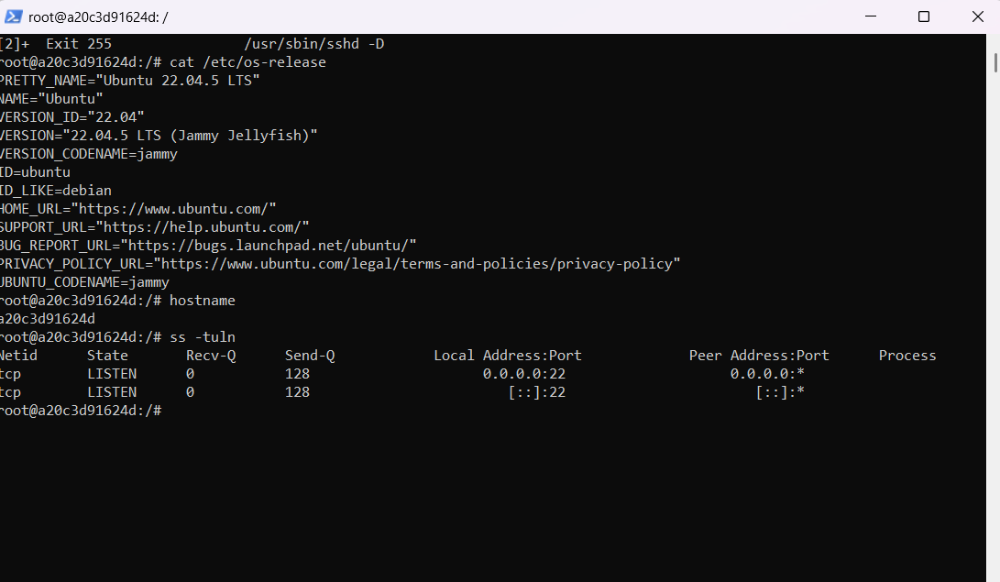

---

## 4. Fehlerbehebung

Während der Vorbereitung des Containers sind mehrere Probleme bei der Paketinstallation aufgetreten.

### 4.1 Fehler beim Einfügen eines Befehls

Beim Einfügen des Befehls `apt update` wurden zusätzliche Steuerzeichen in das Terminal übernommen.

```text
bash: $'\E[200~apt': command not found
```

Der Befehl konnte deshalb nicht ausgeführt werden.

Das Problem wurde durch erneutes, korrektes Eingeben des Befehls behoben.

### 4.2 Fehlerhafte Paketdownloads

Beim Aktualisieren der Paketlisten und beim Herunterladen von Installationspaketen trat mehrfach folgender Fehler auf:

```text
Hash Sum mismatch
```

Die erwartete SHA256-Prüfsumme stimmte nicht mit der Prüfsumme der heruntergeladenen Datei überein.

Dadurch verweigerte APT die Installation der betroffenen Pakete.

Unter anderem konnte das Paket `iproute2` zunächst nicht installiert werden.

```text
E: Package 'iproute2' has no installation candidate
```

### 4.3 Fehlender SSH-Dienst

Da die Paketinstallation nicht vollständig abgeschlossen worden war, konnte SSH zunächst nicht gestartet werden.

```text
bash: /usr/sbin/sshd: No such file or directory
```

### 4.4 Durchgeführte Fehlerbehebung

Zur Fehlerbehebung wurden die Paketlisten und der Paketcache bereinigt.

```bash
apt-get clean
rm -rf /var/lib/apt/lists/*
```

Anschliessend wurden die Paketlisten erneut heruntergeladen.

```bash
apt-get update -o Acquire::http::No-Cache=true -o Acquire::Retries=3 -o APT::Update::Error-Mode=any
```

Zusätzlich wurden alternative Ubuntu-Paketquellen und die Verwendung von HTTPS als Lösungsansätze berücksichtigt.

Nach mehreren Installationsversuchen konnten die benötigten Programme erfolgreich installiert und der SSH-Dienst gestartet werden.

Die genaue Ursache der fehlerhaften Downloads konnte nicht abschliessend bestimmt werden. Ein Netzwerkcache, Proxy oder fehlerhafte Übertragungen kommen als mögliche Ursachen infrage.

### Sicherheitsrelevanz

Die aufgetretenen Fehler zeigen, weshalb Integritätsprüfungen bei der Softwareinstallation wichtig sind.

APT verhindert die Installation von Paketen, deren Prüfsummen nicht mit den erwarteten Werten übereinstimmen.

Die Sicherheitsprüfungen wurden während der Fehlerbehebung nicht deaktiviert.

---

## 5. IST-Zustand

Vor der eigentlichen Systemhärtung wurde der ursprüngliche Zustand des Containers analysiert.

Für die Speicherung der Ergebnisse wurde ein separates Verzeichnis erstellt.

```bash
mkdir -p /root/hardening-nachweise
cd /root/hardening-nachweise
```

### 5.1 Offene TCP- und UDP-Ports

```bash
ss -tuln | tee 01_ports_vorher.txt
```

### Ergebnis

```text
Netid State  Recv-Q Send-Q Local Address:Port
tcp   LISTEN 0      128    0.0.0.0:22
tcp   LISTEN 0      128    [::]:22
```

| Port | Protokoll | Status | Dienst |
|---|---|---|---|
| 22 | TCP / IPv4 | LISTEN | SSH |
| 22 | TCP / IPv6 | LISTEN | SSH |
| Keine angezeigt | UDP | - | - |

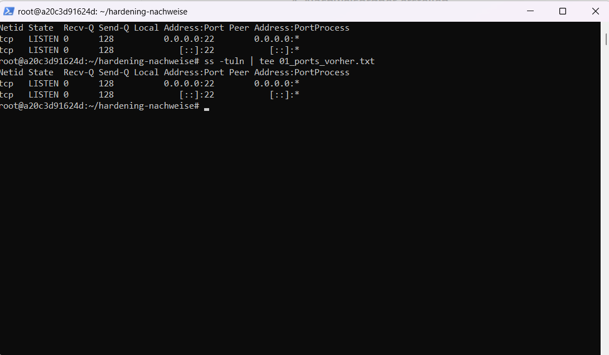

### Auswertung

Der SSH-Dienst lauscht sowohl auf allen IPv4-Schnittstellen als auch auf allen IPv6-Schnittstellen des Containers.

Es wurden keine weiteren lauschenden TCP- oder UDP-Dienste festgestellt.

Die beiden Einträge beziehen sich auf denselben SSH-Port, jedoch auf unterschiedliche IP-Protokollversionen.

Es wurden keine Ports auf dem Windows-Host veröffentlicht.

---

### 5.2 Laufende Prozesse

```bash
ps aux | tee 02_prozesse_vorher.txt
```

### Ergebnisse

| PID | Benutzer | Prozess | Funktion |
|---|---|---|---|
| 1 | root | /bin/bash | Hauptprozess des Containers |
| 4300 | root | sshd | SSH-Server |
| 4319 | root | ps aux | Prozessanalyse |
| 4320 | root | tee | Speicherung der Ausgabe |

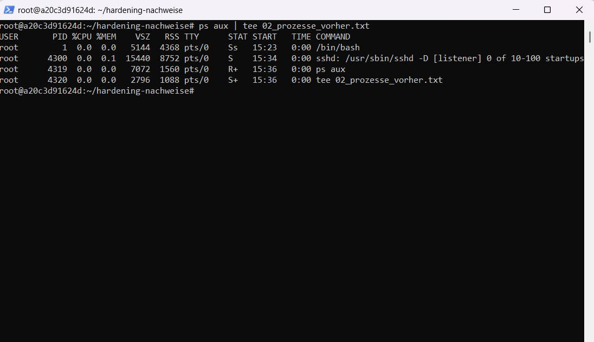

### Auswertung

Der Container besitzt nur wenige laufende Prozesse.

Neben der Bash-Shell läuft der SSH-Dienst.

Die Prozesse `ps` und `tee` wurden lediglich zur Erfassung und Speicherung der Untersuchungsergebnisse gestartet.

Es wurden keine weiteren dauerhaft laufenden Netzwerkdienste festgestellt.

---

### 5.3 Benutzerkonten

```bash
cat /etc/passwd | tee 03_benutzer_vorher.txt
ls -la /home | tee 04_home_vorher.txt
```

### Festgestellte Benutzerkonten

| Benutzer | UID | Funktion |
|---|---:|---|
| root | 0 | Systemadministrator |
| daemon | 1 | Systemkonto |
| bin | 2 | Systemkonto |
| sys | 3 | Systemkonto |
| sync | 4 | Systemkonto |
| games | 5 | Systemkonto |
| man | 6 | Systemkonto |
| lp | 7 | Druckdienstkonto |
| mail | 8 | Mail-Systemkonto |
| news | 9 | Systemkonto |
| uucp | 10 | Systemkonto |
| proxy | 13 | Proxy-Systemkonto |
| www-data | 33 | Webserver-Systemkonto |
| backup | 34 | Backup-Systemkonto |
| list | 38 | Mailinglisten-Systemkonto |
| irc | 39 | IRC-Systemkonto |

Die Tabelle enthält die Benutzerkonten aus der vorliegenden Terminal-Ausgabe.

Die meisten dieser Konten besitzen `/usr/sbin/nologin` als Login-Shell und sind nicht für interaktive Benutzeranmeldungen vorgesehen.

### Home-Verzeichnisse

```text
total 8
drwxr-xr-x 2 root root 4096 Apr 18 2022 .
drwxr-xr-x 1 root root 4096 Nov 26 15:03 ..
```

Das Verzeichnis `/home` enthielt vor der Härtung keine Benutzerverzeichnisse.

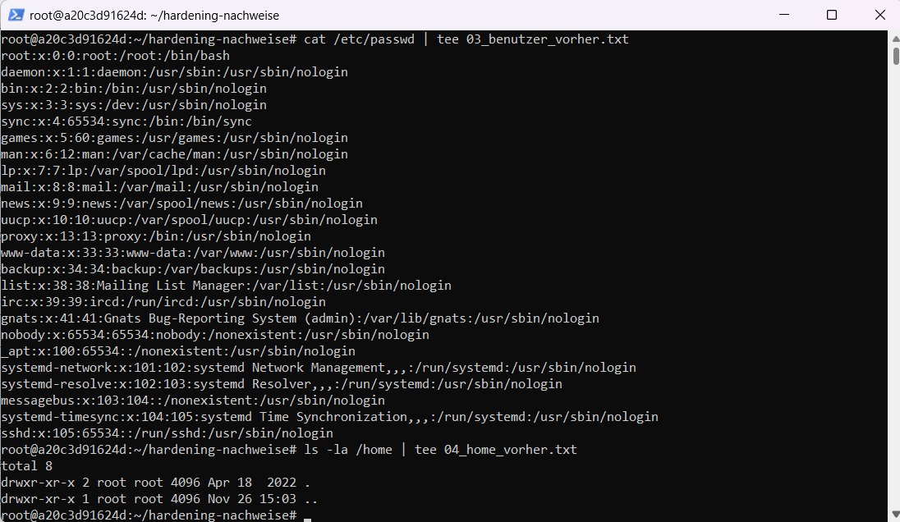

### Auswertung

Vor der Härtung wurde hauptsächlich mit dem Root-Benutzer gearbeitet.

Ein separater administrativer Benutzer namens `student` existierte noch nicht.

Die dauerhafte Verwendung des Root-Kontos erhöht das Risiko, dass Fehler oder kompromittierte Programme umfangreiche Systemänderungen durchführen können.

---

### 5.4 SSH-Konfiguration

```bash
/usr/sbin/sshd -T | grep -E '^(permitrootlogin|passwordauthentication|pubkeyauthentication|port) ' | tee 05_ssh_vorher.txt
```

### Ergebnis

```text
port 22
permitrootlogin without-password
pubkeyauthentication yes
passwordauthentication yes
```

| Einstellung | Ursprünglicher Wert | Bedeutung |
|---|---|---|
| Port | 22 | Standard-SSH-Port |
| PermitRootLogin | without-password | Root-Anmeldung ohne Passwort, beispielsweise mit SSH-Schlüssel, möglich |
| PubkeyAuthentication | yes | Schlüsselbasierte Anmeldung erlaubt |
| PasswordAuthentication | yes | Passwortbasierte Anmeldung grundsätzlich erlaubt |

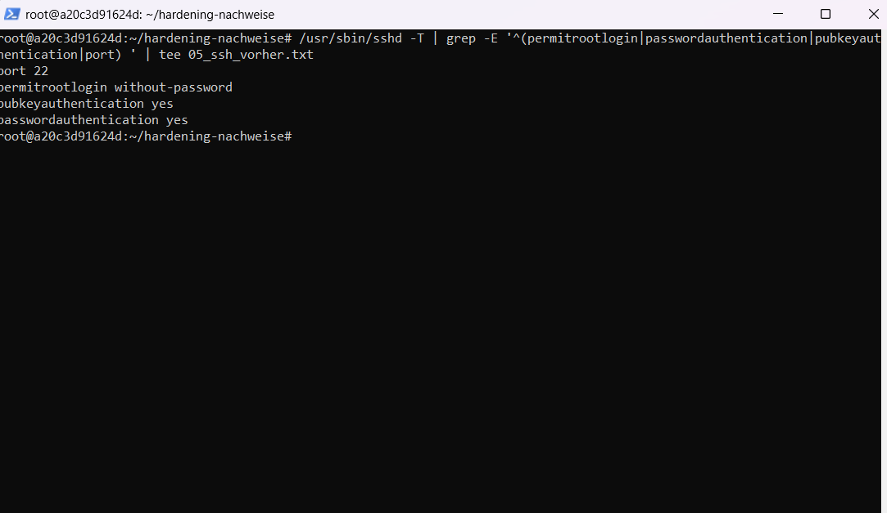

### Auswertung

Der SSH-Root-Login war vor der Härtung nicht vollständig deaktiviert.

Die Einstellung `without-password` verhindert die passwortbasierte SSH-Anmeldung als Root, erlaubt aber weiterhin bestimmte andere Authentifizierungsmethoden.

Um direkte SSH-Anmeldungen als Root vollständig zu verhindern, muss die Einstellung auf `no` geändert werden.

---

### 5.5 Installierte Software

Zur Erfassung der installierten Software wurde die Paketliste gespeichert.

```bash
dpkg -l > 06_pakete_vorher.txt
```

Die Paketliste dient als Grundlage für die spätere Überprüfung entfernter Programme.

---

### 5.6 Zusammenfassung des IST-Zustands

| Eigenschaft | IST-Zustand |
|---|---|
| Betriebssystem | Ubuntu 22.04 LTS |
| Hauptprozess | Bash |
| Netzwerkdienst | OpenSSH |
| Offene TCP-Ports | 22 |
| Offene UDP-Ports | Keine angezeigt |
| SSH über IPv4 | Aktiv |
| SSH über IPv6 | Aktiv |
| Direkter SSH-Root-Login | Teilweise erlaubt |
| Root-Passwortstatus | Vorher nicht überprüft |
| Benutzer student | Nicht vorhanden |
| Home-Verzeichnisse | Keine regulären Benutzerverzeichnisse |
| UFW | Noch nicht eingerichtet |
| Nano | Installiert |
| Net-tools | Installiert |

---

## 6. Härtungsmassnahmen

Im folgenden Abschnitt werden die durchgeführten Härtungsmassnahmen beschrieben.

Für jede Massnahme wird erläutert:

1. Was wurde durchgeführt?
2. Warum verbessert die Massnahme die Sicherheit?
3. Wie wurde die Wirksamkeit überprüft?

---

### 6.1 Massnahme 1 – SSH-Root-Login deaktivieren

#### Was habe ich gemacht?

Zuerst wurde eine Sicherung der ursprünglichen SSH-Konfiguration erstellt.

```bash
cp /etc/ssh/sshd_config /etc/ssh/sshd_config.bak
```

Anschliessend wurde eine separate Hardening-Konfiguration erstellt.

```bash
mkdir -p /etc/ssh/sshd_config.d
printf 'PermitRootLogin no\n' > /etc/ssh/sshd_config.d/00-hardening.conf
```

Die Konfiguration wurde auf Fehler überprüft und der SSH-Dienst neu geladen.

```bash
/usr/sbin/sshd -t && kill -HUP "$(cat /run/sshd.pid)"
```

#### Warum ist das sicher?

Der Root-Benutzer besitzt vollständige administrative Berechtigungen.

Eine erfolgreiche direkte Root-Anmeldung würde einem Angreifer umfangreiche Kontrolle über den Container ermöglichen.

Durch die Deaktivierung des Root-Logins über SSH wird diese direkte Zugriffsmöglichkeit entfernt.

Administratoren können stattdessen einen normalen Benutzer verwenden und administrative Befehle bei Bedarf über sudo ausführen.

#### Wie wurde die Wirksamkeit überprüft?

```bash
/usr/sbin/sshd -T | grep permitrootlogin
```

### Ergebnis

```text
permitrootlogin no
```

| Zustand | Einstellung |
|---|---|
| Vorher | without-password |
| Nachher | no |

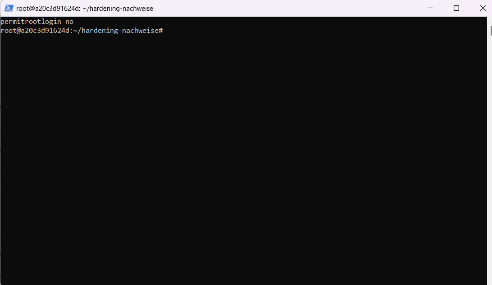

**Bewertung:** Die effektive SSH-Konfiguration bestätigt, dass direkte Root-Anmeldungen über SSH deaktiviert sind.

Ein separater SSH-Anmeldeversuch als Root wurde in den vorliegenden Ergebnissen nicht dokumentiert.

---

### 6.2 Massnahme 2 – Starkes Root-Passwort setzen

#### Was habe ich gemacht?

Für den Root-Benutzer wurde ein neues Passwort gesetzt.

```bash
passwd root
```

Das Passwort wird aus Sicherheitsgründen weder in der Dokumentation noch in den Screenshots veröffentlicht.

#### Warum ist das sicher?

Ein sicheres Passwort erschwert das Erraten von Zugangsdaten.

Auch wenn der direkte SSH-Root-Login deaktiviert wurde, kann das Root-Passwort für andere lokale Authentifizierungsverfahren relevant sein.

Ein sicheres Passwort sollte ausreichend lang, einzigartig und nicht leicht vorhersehbar sein.

#### Wie wurde die Wirksamkeit überprüft?

```bash
passwd -S root
```

### Ergebnis

```text
root P 11/26/2026 0 99999 7 -1
```

| Eigenschaft | Ergebnis |
|---|---|
| Benutzer | root |
| Passwortstatus | P |
| Letzte Passwortänderung | 26.11.2026 |

Der Status `P` bedeutet, dass ein Passwort gesetzt ist.

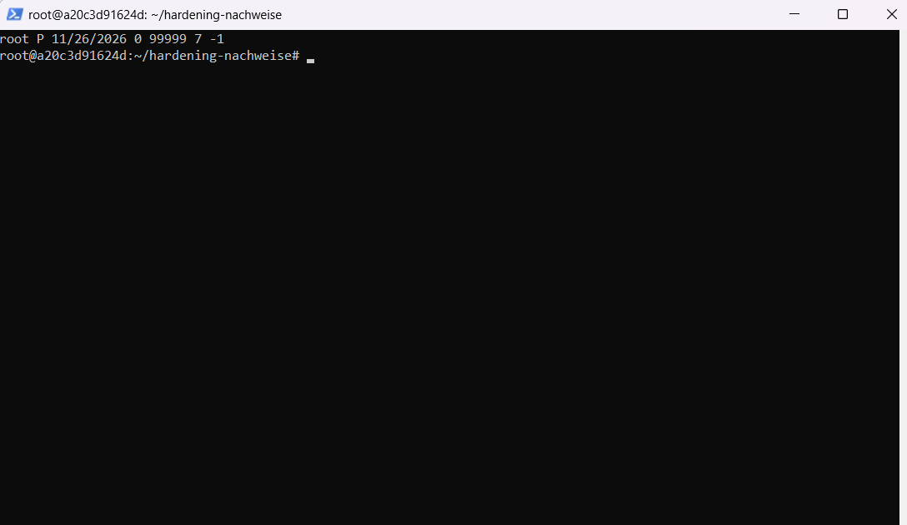

**Bewertung:** Das Setzen des Passworts wurde erfolgreich bestätigt. Die tatsächliche Passwortstärke lässt sich mit diesem Kontrollbefehl nicht überprüfen.

---

### 6.3 Massnahme 3 – Neuen Benutzer mit sudo-Berechtigung erstellen

#### Was habe ich gemacht?

Es wurde ein neuer Benutzer namens `student` erstellt.

```bash
adduser student
```

Anschliessend wurde der Benutzer zur sudo-Gruppe hinzugefügt.

```bash
usermod -aG sudo student
```

#### Warum ist das sicher?

Die tägliche Arbeit sollte nicht dauerhaft mit Root-Berechtigungen durchgeführt werden.

Ein normaler Benutzer besitzt grundsätzlich eingeschränkte Berechtigungen.

Administrative Befehle können bei Bedarf bewusst über sudo ausgeführt werden.

Dadurch wird das Prinzip der minimalen Berechtigungen unterstützt.

#### Wie wurde die Wirksamkeit überprüft?

```bash
id student
groups student
ls -ld /home/student
sudo -l -U student
```

### Ergebnis

```text
uid=1000(student) gid=1000(student)
groups=1000(student),27(sudo)
```

Die Überprüfung der sudo-Berechtigungen ergab:

```text
User student may run the following commands on a20c3d91624d:
    (ALL : ALL) ALL
```

| Eigenschaft | Ergebnis |
|---|---|
| Benutzername | student |
| Benutzer-ID | 1000 |
| Gruppen-ID | 1000 |
| Primäre Gruppe | student |
| Administrative Gruppe | sudo |
| Sudo-Berechtigung | Vorhanden |
| Home-Verzeichnis | /home/student |

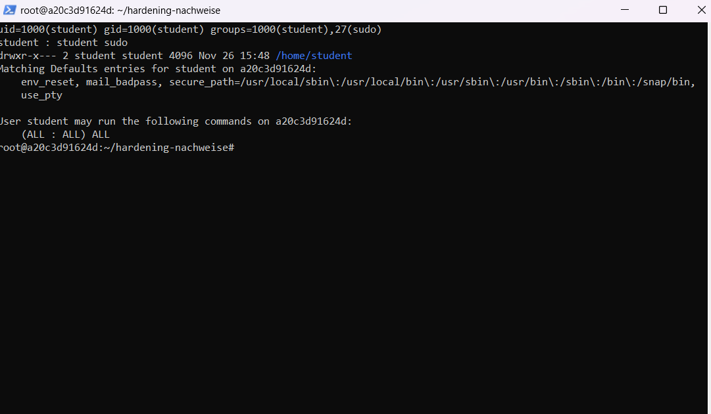

**Bewertung:** Der Benutzer wurde erfolgreich erstellt und besitzt die geforderten sudo-Berechtigungen.

Da der Benutzer sämtliche Befehle über sudo ausführen darf, besitzt er bei erfolgreicher Autorisierung weiterhin umfassende administrative Rechte. In einer produktiven Umgebung könnten diese Berechtigungen zusätzlich eingeschränkt werden.

---

### 6.4 Massnahme 4 – Nur benötigte Netzwerkdienste betreiben

#### Was habe ich gemacht?

Die laufenden Prozesse wurden vor und nach der Härtung überprüft.

```bash
ps aux
```

Zusätzlich wurden alle lauschenden TCP- und UDP-Ports kontrolliert.

```bash
ss -tuln
```

Bereits im IST-Zustand lief ausser SSH kein weiterer dauerhaft lauschender Netzwerkdienst.

Deshalb musste kein zusätzlicher Netzwerkdienst deaktiviert werden.

Nicht benötigte Programme wurden im Rahmen der Softwarebereinigung entfernt.

#### Warum ist das sicher?

Jeder zusätzliche Netzwerkdienst erhöht die potenzielle Angriffsfläche eines Systems.

Nicht benötigte Dienste können Sicherheitslücken enthalten oder falsch konfiguriert sein.

Durch die Beschränkung auf den benötigten SSH-Dienst wird die Angriffsfläche möglichst klein gehalten.

#### Wie wurde die Wirksamkeit überprüft?

```bash
ps aux | tee /root/hardening-nachweise/09_prozesse_nachher.txt
```

### Ergebnis

| PID | Benutzer | Prozess |
|---|---|---|
| 1 | root | /bin/bash |
| 4300 | root | sshd |
| 4893 | root | ps aux |
| 4894 | root | tee |

Die Prozesse `ps` und `tee` dienen ausschliesslich der Überprüfung und Dokumentation.

SSH ist weiterhin der einzige festgestellte dauerhaft laufende Netzwerkdienst.

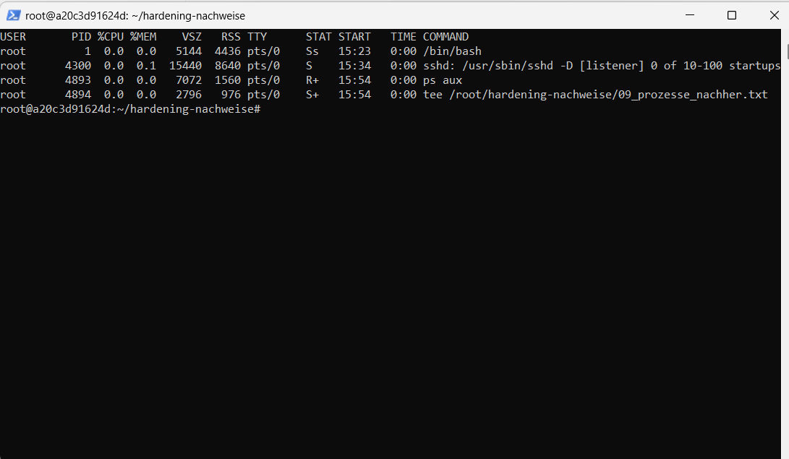

**Bewertung:** Die Anforderung, nur den benötigten SSH-Netzwerkdienst zu betreiben, ist erfüllt.

---

### 6.5 Massnahme 5 – UFW-Firewall installieren und aktivieren

#### Was habe ich gemacht?

Zuerst wurde UFW installiert.

```bash
apt-get install -y ufw
```

Anschliessend wurden die Standardregeln definiert.

```bash
ufw default deny incoming
ufw default allow outgoing
```

Der benötigte SSH-Port wurde ausdrücklich erlaubt.

```bash
ufw allow ssh
```

Danach wurde die Firewall aktiviert.

```bash
ufw --force enable
```

#### Warum ist das sicher?

Eine Firewall kontrolliert eingehende und ausgehende Netzwerkverbindungen.

Durch die Regel `deny incoming` werden eingehende Verbindungen standardmässig blockiert, sofern keine entsprechende Ausnahme oder andere zulässige Firewall-Regel existiert.

Da SSH für diesen Auftrag benötigt wird, wurde Port 22 ausdrücklich freigegeben.

Dadurch wird verhindert, dass beliebige neu gestartete Netzwerkdienste automatisch für andere Systeme erreichbar sind.

#### Wie wurde die Wirksamkeit überprüft?

```bash
ufw status verbose
iptables -S
```

### Ergebnis der UFW-Überprüfung

```text
Status: active
Logging: on (low)
Default: deny (incoming), allow (outgoing), deny (routed)
New profiles: skip

To                         Action      From
--                         ------      ----
22/tcp                     ALLOW IN    Anywhere
22/tcp (v6)                ALLOW IN    Anywhere (v6)
```

### Relevante iptables-Regeln

```text
-P INPUT DROP
-P FORWARD DROP
-P OUTPUT ACCEPT
-A ufw-user-input -p tcp -m tcp --dport 22 -j ACCEPT
```

### Zusammenfassung der Firewall-Konfiguration

| Regel | Aktion |
|---|---|
| Eingehende Verbindungen | Standardmässig blockieren |
| Ausgehende Verbindungen | Erlauben |
| Weitergeleitete Verbindungen | Standardmässig blockieren |
| SSH über IPv4 | Erlauben |
| SSH über IPv6 | Erlauben |
| Logging | Aktiv, Stufe low |

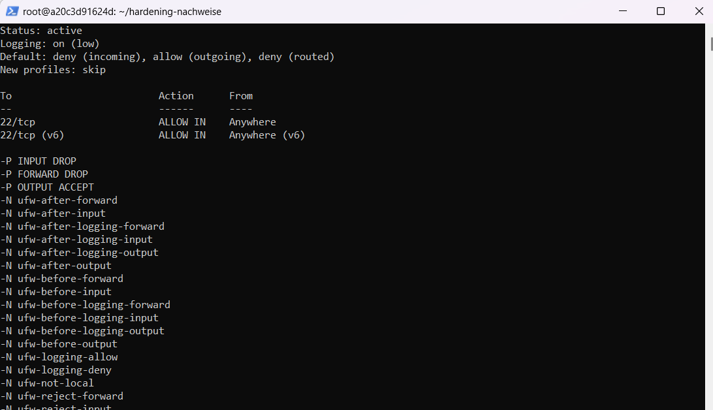

**Bewertung:** UFW ist erfolgreich aktiviert. Die iptables-Ausgabe bestätigt, dass die Firewall-Regeln im Container eingerichtet wurden.

Die Wirksamkeit wurde auf Konfigurationsebene überprüft. Ein zusätzlicher praktischer Verbindungstest von einem anderen Container wurde nicht dokumentiert.

---

### 6.6 Massnahme 6 – TCP- und UDP-Ports erneut überprüfen

#### Was habe ich gemacht?

Nach der Härtung wurden die offenen TCP- und UDP-Ports erneut untersucht.

```bash
ss -tuln | tee /root/hardening-nachweise/08_ports_nachher.txt
```

#### Warum ist das sicher?

Durch die erneute Überprüfung kann festgestellt werden, ob zusätzliche oder unerwartete Dienste gestartet wurden.

Ausserdem kann kontrolliert werden, ob der benötigte SSH-Dienst weiterhin verfügbar ist.

#### Wie wurde die Wirksamkeit überprüft?

### Ergebnis

```text
Netid State  Recv-Q Send-Q Local Address:Port
tcp   LISTEN 0      128    0.0.0.0:22
tcp   LISTEN 0      128    [::]:22
```

### Vergleich

| Port | Vorher | Nachher |
|---|---|---|
| 22/TCP IPv4 | LISTEN | LISTEN |
| 22/TCP IPv6 | LISTEN | LISTEN |
| Weitere TCP-Ports | Keine | Keine |
| UDP-Ports | Keine angezeigt | Keine angezeigt |

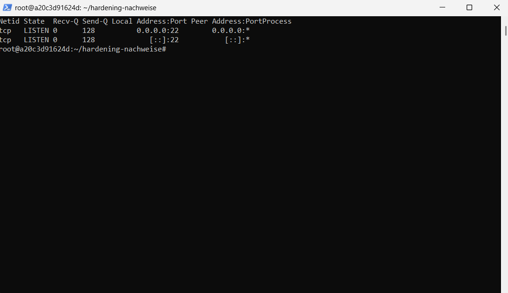

### Auswertung

Die Anzahl der lauschenden Ports hat sich nicht verändert.

Dies ist korrekt, da SSH der einzige benötigte Netzwerkdienst ist und weiterhin verfügbar bleiben soll.

Die Firewall verändert nicht zwingend die Ausgabe von `ss`, da dieses Werkzeug lauschende Dienste anzeigt und nicht deren Erreichbarkeit durch die Firewall beurteilt.

**Bewertung:** Die Portüberprüfung wurde erfolgreich durchgeführt. Es wurden keine zusätzlichen lauschenden Netzwerkdienste festgestellt.

---

### 6.7 Massnahme 7 – IPv6 deaktivieren (optional)

Die Deaktivierung von IPv6 ist gemäss Aufgabenstellung optional.

In meiner Testumgebung wurde IPv6 nicht deaktiviert.

SSH lauscht weiterhin auf IPv4 und IPv6. UFW enthält entsprechende SSH-Regeln für beide Protokollversionen.

Eine pauschale Deaktivierung von IPv6 ist nicht zwingend erforderlich, sofern das Protokoll korrekt abgesichert und die Firewall entsprechend konfiguriert ist.

**Bewertung:** Optionale Massnahme bewusst nicht umgesetzt.

---

### 6.8 Massnahme 8 – Unnötige Software entfernen

#### Was habe ich gemacht?

Die Programme `nano` und `net-tools` wurden entfernt, da sie für den weiteren Betrieb des Containers nicht benötigt werden.

```bash
apt-get purge -y nano net-tools
apt-get clean
```

Das Paket `iproute2` wurde beibehalten, da es für die Überprüfung der Netzwerkschnittstellen und Ports benötigt wird.

#### Warum ist das sicher?

Jedes zusätzlich installierte Softwarepaket kann potenziell Sicherheitslücken enthalten.

Durch das Entfernen unnötiger Programme wird die Anzahl möglicher Schwachstellen reduziert.

Ein minimaler Container ist ausserdem einfacher zu verwalten und zu aktualisieren.

#### Wie wurde die Wirksamkeit überprüft?

```bash
dpkg -l nano net-tools openssh-server iproute2 sudo ufw
```

### Ergebnis

```text
dpkg-query: no packages found matching net-tools
```

| Paket | Version | Status |
|---|---|---|
| nano | Keine | Nicht installiert |
| net-tools | Keine | Nicht installiert |
| iproute2 | 5.15.0-1ubuntu2.2 | Installiert |
| openssh-server | 1:8.9p1-3ubuntu0.18 | Installiert |
| sudo | 1.9.9-1ubuntu2.7 | Installiert |
| ufw | 0.36.1-4ubuntu0.1 | Installiert |

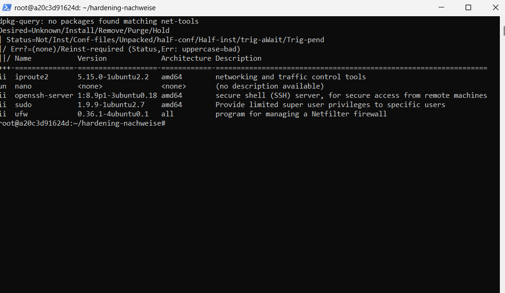

**Bewertung:** Die nicht benötigten Programme wurden erfolgreich entfernt. Die für den sicheren Betrieb und die Überprüfung benötigten Programme bleiben installiert.

---

### 6.9 Abschliessende Überprüfung der Benutzerkonten

Nach Abschluss der Härtungsmassnahmen wurden die Benutzerkonten erneut überprüft.

```bash
getent passwd root student
groups student
ls -la /home
```

Der Benutzer `student` ist vorhanden und Mitglied der sudo-Gruppe.

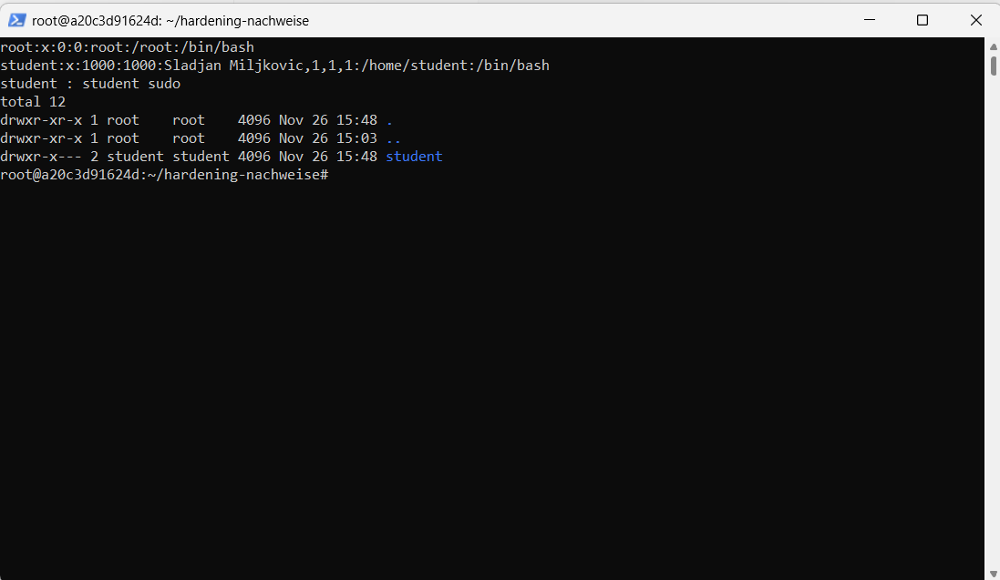

Die administrative Arbeit kann somit über einen separaten Benutzer erfolgen.

---

## 7. Vorher-Nachher-Vergleich

Die folgende Tabelle fasst die wichtigsten Veränderungen durch die Systemhärtung zusammen.

| Eigenschaft | Vorher | Nachher |
|---|---|---|
| Betriebssystem | Ubuntu 22.04 | Ubuntu 22.04 |
| SSH-Root-Login | without-password | no |
| Root-Passwort | Nicht überprüft | Gesetzt |
| Benutzer student | Nicht vorhanden | Vorhanden |
| Sudo-Gruppe für student | Nicht vorhanden | Aktiv |
| UFW-Firewall | Nicht eingerichtet | Aktiv |
| Eingehender Netzwerkverkehr | Keine UFW-Regeln eingerichtet | Standardmässig blockiert |
| Ausgehender Netzwerkverkehr | Keine UFW-Regeln eingerichtet | Erlaubt |
| Weitergeleiteter Netzwerkverkehr | Keine UFW-Regeln eingerichtet | Standardmässig blockiert |
| SSH-Port IPv4 | 22/TCP | 22/TCP |
| SSH-Port IPv6 | 22/TCP | 22/TCP |
| Weitere lauschende TCP-Ports | Keine | Keine |
| Lauschende UDP-Ports | Keine angezeigt | Keine angezeigt |
| Nano | Installiert | Entfernt |
| Net-tools | Installiert | Entfernt |
| Firewall-Logging | Nicht eingerichtet | Aktiv |
| Netzwerkdienste | SSH | SSH |

### Bewertung der Massnahmen

| Massnahme | Ergebnis |
|---|---|
| SSH-Root-Login deaktivieren | Erfolgreich |
| Root-Passwort setzen | Erfolgreich |
| Benutzer student erstellen | Erfolgreich |
| Nur benötigte Dienste betreiben | Erfolgreich |
| UFW installieren und aktivieren | Erfolgreich |
| TCP- und UDP-Ports überprüfen | Erfolgreich |
| IPv6 deaktivieren | Optional, nicht durchgeführt |
| Unnötige Software entfernen | Erfolgreich |

Durch die Härtung wurde insbesondere die Benutzerverwaltung und die Kontrolle eingehender Netzwerkverbindungen verbessert.

Obwohl die Anzahl der offenen Ports unverändert geblieben ist, wurden zusätzliche Schutzmechanismen eingerichtet.

---

## 8. Container speichern

Damit die vorgenommenen Änderungen später wiederverwendet werden können, kann der gehärtete Container als neues Docker-Image gespeichert werden.

### 8.1 Container verlassen

Innerhalb des Ubuntu-Containers:

```bash
exit
```

### 8.2 Docker-Image erstellen

In Windows PowerShell:

```powershell
docker commit hardeninglab hardened-ubuntu
```

Mit `docker commit` werden die Änderungen am Dateisystem des Containers in einem neuen Docker-Image gespeichert.

### 8.3 Image überprüfen

```powershell
docker images hardened-ubuntu
docker ps -a --filter name=hardeninglab
```

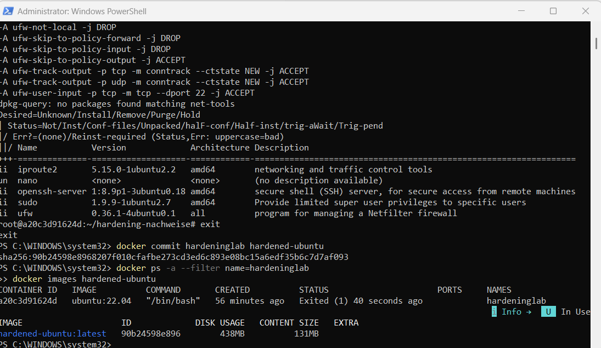

Der Docker-Commit muss durch die Ausgabe des erstellten Images beziehungsweise durch den Screenshot bestätigt werden.

### 8.4 Was wird gespeichert?

| Eigenschaft | Durch Docker-Commit gespeichert |
|---|---|
| Installierte Programme | Ja |
| Entfernte Programme | Ja |
| Benutzerkonten | Ja |
| Passwort-Hashes | Ja |
| SSH-Konfigurationsdateien | Ja |
| UFW-Konfigurationsdateien | Ja |
| Gespeicherte Untersuchungsergebnisse | Ja |
| Laufende Prozesse | Nein |
| Aktive Kernel-Firewall-Regeln | Nein |
| Laufzeit-Capabilities | Nein |

Das gespeicherte Image enthält sicherheitsrelevante Informationen, beispielsweise Passwort-Hashes und SSH-Hostschlüssel.

Aus diesem Grund sollte es nicht öffentlich veröffentlicht werden.

Für produktive Umgebungen wäre ein reproduzierbares Dockerfile einer rein manuellen Image-Erstellung vorzuziehen.

---

## 9. Erfolgskontrolle nach Neustart

### 9.1 Gehärtetes Image starten

Das gespeicherte Image kann mit folgendem Befehl erneut gestartet werden:

```powershell
docker run --rm -it --name hardening-test --cap-add=NET_ADMIN hardened-ubuntu /bin/bash
```

Dabei wird ein separater Testcontainer erstellt.

Der ursprüngliche Container `hardeninglab` bleibt unverändert.

### 9.2 Dienste und Firewall aktivieren

Innerhalb des neu erstellten Containers:

```bash
mkdir -p /run/sshd
ufw --force enable
/usr/sbin/sshd -D &
```

Da Docker-Images keine laufenden Prozesse oder aktiven Kernel-Firewall-Regeln speichern, müssen SSH und UFW beim Neustart erneut aktiviert werden.

### 9.3 Gespeicherte Einstellungen überprüfen

```bash
hostname
/usr/sbin/sshd -T | grep permitrootlogin
id student
passwd -S root
ufw status verbose
ss -tuln
```

### Erwartete Ergebnisse

| Überprüfung | Erwartetes Ergebnis |
|---|---|
| SSH-Root-Login | permitrootlogin no |
| Benutzer student | Vorhanden |
| Sudo-Gruppe | Vorhanden |
| Root-Passwort | Gesetzt |
| UFW | Status active |
| SSH | Port 22 verfügbar |

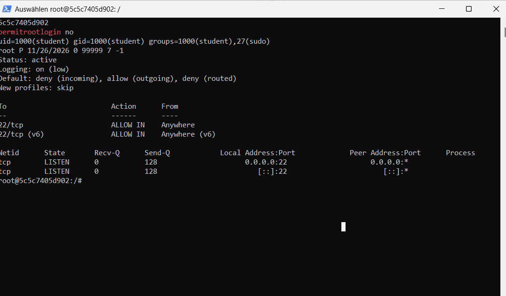

Der erfolgreiche Neustart und die Übernahme der gespeicherten Einstellungen werden anhand der tatsächlichen Terminal-Ausgabe beziehungsweise des Screenshots überprüft.

### 9.4 Testcontainer verlassen

```bash
exit
```

Durch den Parameter `--rm` wird der temporäre Testcontainer beim Beenden automatisch entfernt.

Das gespeicherte Image `hardened-ubuntu` bleibt erhalten.

### 9.5 Ursprünglichen Container erneut starten

Der ursprüngliche Container kann unabhängig vom gespeicherten Image erneut gestartet werden.

```powershell
docker start -ai hardeninglab
```

Auch hier müssen die benötigten Dienste und aktiven Firewall-Regeln gegebenenfalls erneut eingerichtet werden.

---

## 10. Reflexionsfragen

### 10.1 Welche Dienste waren unnötig offen?

Bei der Analyse des IST-Zustands wurde festgestellt, dass lediglich der SSH-Dienst auf Port 22 lauschte.

Weitere offene TCP- oder UDP-Dienste wurden nicht festgestellt.

Da SSH für diesen Auftrag benötigt wird, musste dieser Dienst nicht deaktiviert werden.

Allerdings lauschte SSH auf allen IPv4- und IPv6-Schnittstellen des Containers.

Durch die Einrichtung von UFW wurde der eingehende Netzwerkverkehr grundsätzlich eingeschränkt.

Zusätzlich wurden die nicht benötigten Programme `nano` und `net-tools` entfernt.

Diese Programme waren keine lauschenden Netzwerkdienste, stellten jedoch zusätzliche installierte Software dar.

---

### 10.2 Welche Konfiguration war besonders sicherheitsrelevant?

Besonders sicherheitsrelevant war die Deaktivierung des direkten SSH-Root-Logins.

Vor der Härtung war folgende Einstellung vorhanden:

```text
permitrootlogin without-password
```

Nach der Härtung lautet die Einstellung:

```text
permitrootlogin no
```

Dadurch werden direkte SSH-Anmeldungen mit dem Root-Konto verhindert.

Eine weitere wichtige Massnahme war die Einrichtung der UFW-Firewall.

Durch die Standardregel `deny incoming` werden eingehende Netzwerkverbindungen grundsätzlich eingeschränkt.

Zusammen mit einem separaten Benutzer und der Verwendung von sudo wird das Risiko unautorisierter administrativer Zugriffe reduziert.

---

### 10.3 Wie unterscheidet sich ein gehärteter Container von einem Vanilla-Image?

Ein Vanilla-Image ist ein unverändertes Basis-Image, das hauptsächlich die Standardkonfiguration des Betriebssystems enthält.

Ein gehärteter Container wurde gezielt überprüft und an die tatsächlichen Sicherheitsanforderungen angepasst.

| Vanilla-Image | Gehärteter Container |
|---|---|
| Standardkonfiguration | Gezielte Sicherheitskonfiguration |
| Root als Standardbenutzer | Separater administrativer Benutzer vorhanden |
| Keine individuell konfigurierte UFW-Firewall | Definierte Firewall-Regeln |
| Keine individuelle SSH-Härtung | Direkter SSH-Root-Login deaktiviert |
| Allgemeiner Softwarebestand | Auf benötigte Programme angepasster Softwarebestand |
| Keine individuelle Sicherheitsprüfung | Dokumentierte Sicherheitskontrollen |

Ein gehärteter Container soll möglichst wenige unnötige Programme und Netzwerkdienste enthalten.

Ausserdem sollen Benutzerrechte, Netzwerkzugriffe und Konfigurationen bewusst eingeschränkt werden.

Bei Docker muss zusätzlich beachtet werden, dass Container bereits durch verschiedene Isolationsmechanismen geschützt werden.

Die zusätzliche Vergabe von `NET_ADMIN` ist für diese Übung notwendig, erweitert jedoch die Berechtigungen des Containers. In produktiven Umgebungen sollte eine solche Berechtigung möglichst vermieden werden.

---

### 10.4 Wo hat KI tatsächlich geholfen?

Für die Durchführung dieses Auftrags habe ich ChatGPT als Unterstützung verwendet.

Die KI hat mir insbesondere bei folgenden Aufgaben geholfen:

- Strukturierung des Auftrags
- Erklärung der einzelnen Linux-Befehle
- Erstellung eines Vorgehensplans
- Unterstützung bei der Fehleranalyse
- Konfiguration des SSH-Dienstes
- Einrichtung der UFW-Firewall
- Interpretation der Terminal-Ausgaben
- Planung der Screenshots
- Erstellung der Markdown-Dokumentation

Besonders hilfreich war die Unterstützung bei der Interpretation der Fehlermeldungen während der Paketinstallation.

Die KI erklärte mir, dass ein `Hash Sum mismatch` auf eine Abweichung zwischen erwarteter und tatsächlicher Prüfsumme hinweist.

Dadurch konnte ich nachvollziehen, weshalb APT die Installation verweigerte.

---

### 10.5 Wo lag die KI daneben?

Nicht alle vorgeschlagenen Lösungsansätze haben sofort funktioniert.

Bei der Paketinstallation schlug die KI zunächst vor, den Paketcache und die Paketlisten zu bereinigen.

Obwohl dies grundsätzlich ein sinnvoller Lösungsansatz ist, trat der Fehler weiterhin auf.

Auch der Wechsel des Ubuntu-Mirrors führte nicht unmittelbar zur erfolgreichen Installation.

Erst nach weiteren Installationsversuchen konnten die benötigten Programme installiert werden.

Die genaue Ursache des Downloadproblems wurde nicht abschliessend festgestellt.

Ausserdem zeigte sich, dass allgemeine Linux-Empfehlungen nicht immer direkt auf Docker-Container übertragen werden können.

Die Empfehlungen mussten deshalb anhand der tatsächlichen Terminal-Ausgaben überprüft werden.

Ich habe gelernt, dass KI bei der Fehlersuche unterstützen kann, ihre Vorschläge jedoch nicht automatisch korrekt oder erfolgreich sind.

---

### 10.6 Wo musste die Empfehlung an den Container angepasst werden?

Eine wichtige Anpassung betraf die Erstellung des Containers.

Für die Verwendung von UFW wurde der folgende zusätzliche Parameter benötigt:

```text
--cap-add=NET_ADMIN
```

Ohne diese Netzwerkadministrationsberechtigung können Firewall-Änderungen innerhalb eines Docker-Containers fehlschlagen.

Eine weitere Anpassung betraf das Starten des SSH-Dienstes.

Da der Container nicht mit einem vollständigen systemd-Init-System gestartet wurde, wurde SSH direkt ausgeführt:

```bash
/usr/sbin/sshd -D &
```

Auch beim Speichern des Containers musste berücksichtigt werden, dass Docker keine laufenden Prozesse und aktiven Kernel-Firewall-Regeln in einem Image speichert.

Deshalb müssen SSH und UFW beim erneuten Start entsprechend aktiviert werden.

Diese Besonderheiten zeigen, dass eine Systemhärtung in einem Docker-Container teilweise anders durchgeführt werden muss als auf einem herkömmlichen Ubuntu-Server.

---

## 11. Fazit

Durch diesen Auftrag konnte ich grundlegende Massnahmen der Systemhärtung praktisch anwenden.

Zuerst habe ich einen Ubuntu-22.04-Container erstellt und einen SSH-Dienst eingerichtet.

Anschliessend wurde der IST-Zustand anhand der offenen Ports, laufenden Prozesse, Benutzerkonten und SSH-Konfiguration dokumentiert.

Dabei stellte ich fest, dass ein minimaler Docker-Container bereits eine vergleichsweise geringe Angriffsfläche besitzt.

Trotzdem konnten verschiedene zusätzliche Sicherheitsmassnahmen erfolgreich umgesetzt werden.

Zu den wichtigsten Massnahmen gehören:

- Deaktivierung des direkten SSH-Root-Logins
- Setzen eines Root-Passworts
- Erstellung eines separaten Benutzers
- Verwendung von sudo
- Aktivierung einer Firewall
- Entfernung unnötiger Software
- Überprüfung laufender Netzwerkdienste

Besonders lehrreich waren die Probleme bei der Paketinstallation. Diese haben mir gezeigt, wie wichtig die Integritätsprüfung von Softwarepaketen ist.

Ausserdem habe ich gelernt, dass die Anzahl offener Ports allein nicht ausreicht, um die Sicherheit eines Systems zu beurteilen.

Obwohl vor und nach der Härtung weiterhin der SSH-Port 22 geöffnet war, konnte die Sicherheit durch die angepasste SSH-Konfiguration, Benutzerverwaltung und Firewall verbessert werden.

Die Ergebnisse der durchgeführten Kontrollbefehle bestätigen die vorgenommenen Härtungsmassnahmen.

---
